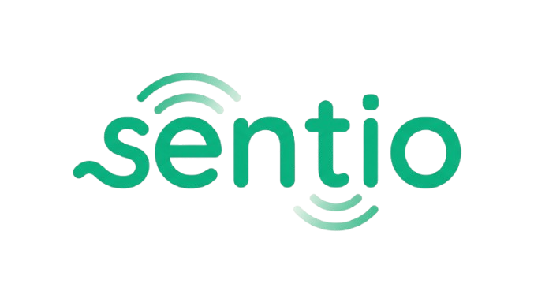
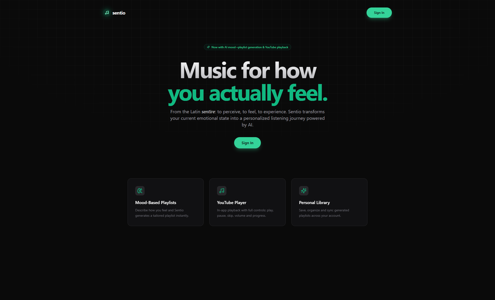
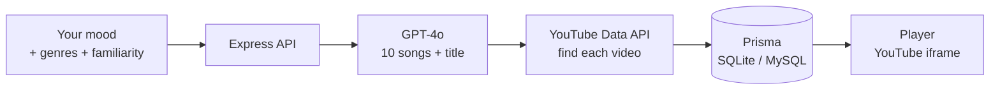
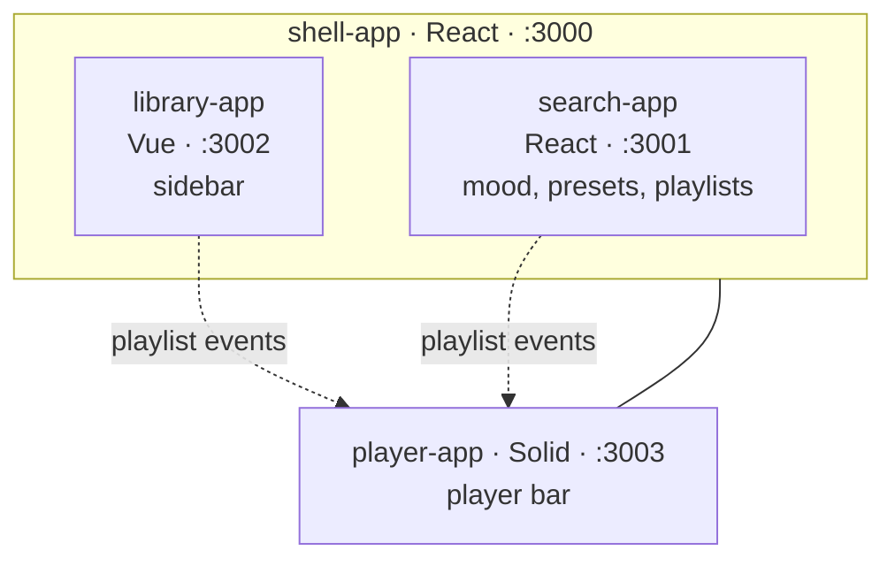
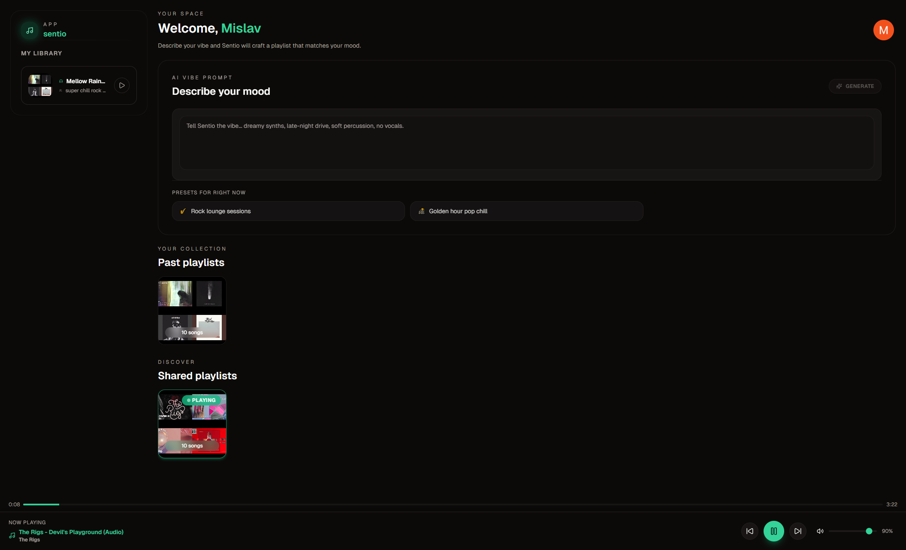
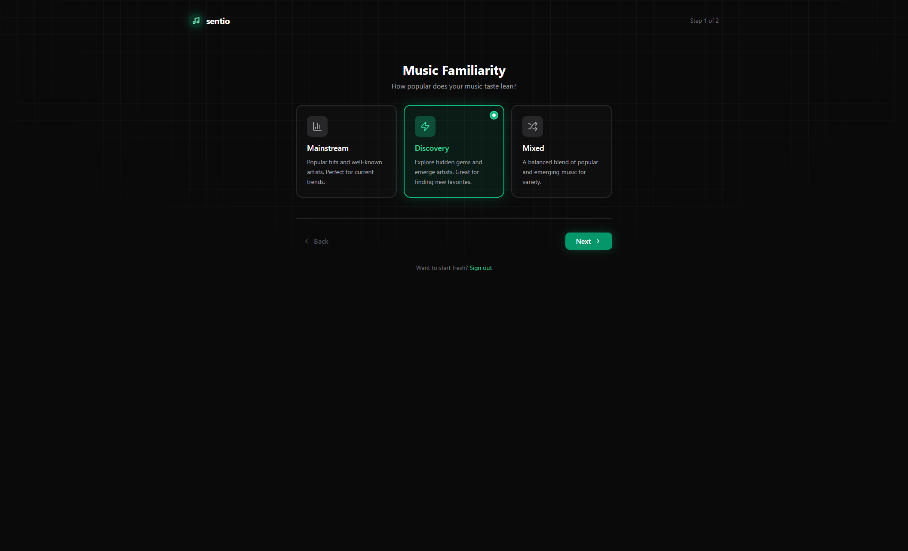
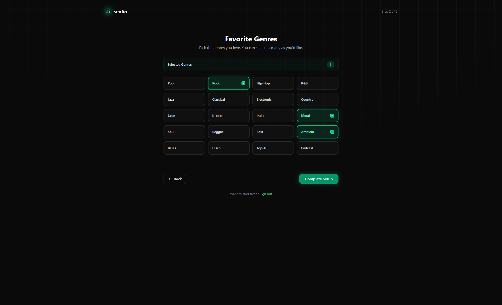
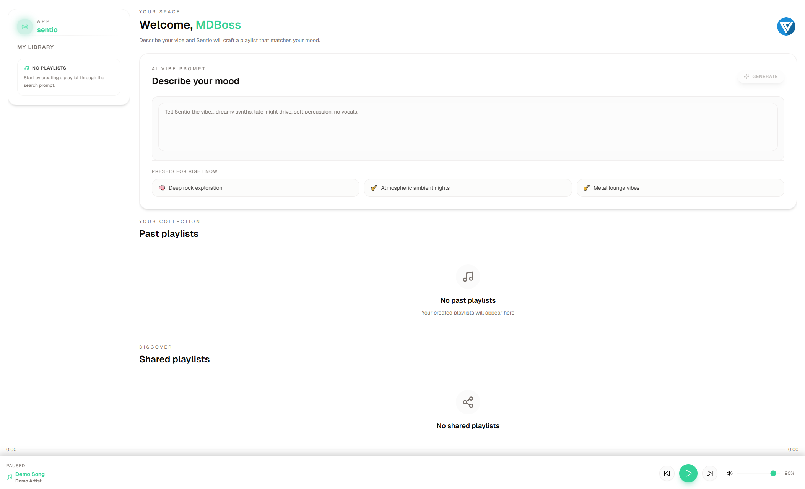
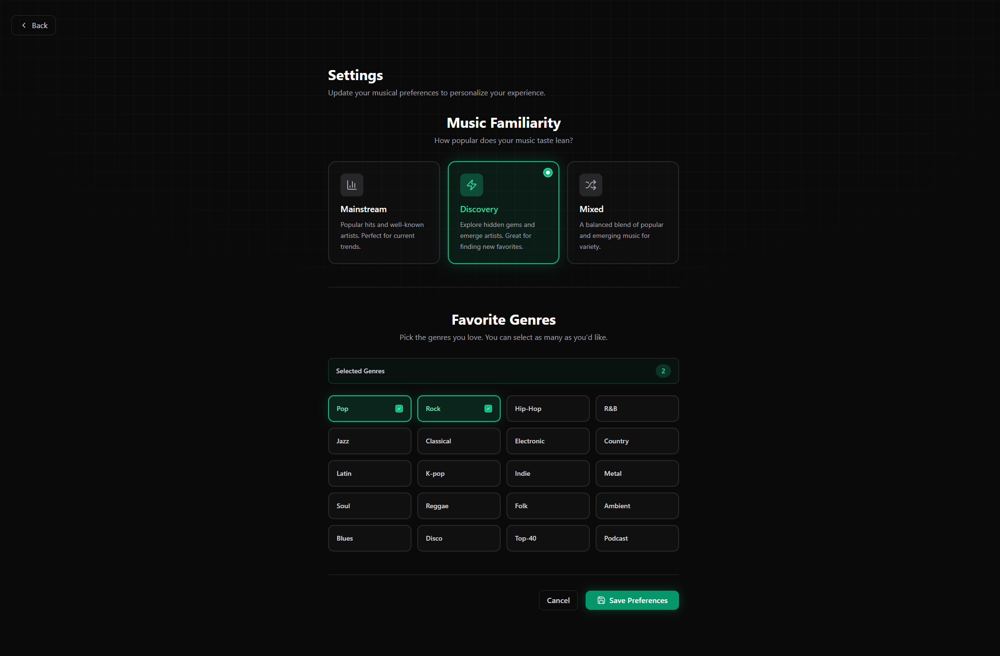

<p align="center">
  
</p>

<h3 align="center">Music for how you actually feel.</h3>

<p align="center">
  Describe your mood in a sentence and Sentio builds a playlist for it with AI, finds every song on YouTube and plays it right in the app.
</p>

<p align="center">
  
  
  
  
  <br>
  
  
  
  
  
</p>



## ✨ What it does

- **Mood to playlist.** Type how you feel ("rainy Sunday, slow coffee, nothing sad") and GPT-4o picks 10 songs that fit, with a short playlist title.
- **Tuned to you.** On first sign-in you choose your genres and how adventurous you are: *Mainstream*, *Discovery* or *Mixed*. Every playlist follows those settings.
- **Ready-made moods.** Presets change with your genres and the time of day, from "Pop morning energy" to late-night picks.
- **Plays in the app.** Each song is matched to a YouTube video and plays in the player bar, with play, pause, skip, volume and progress.
- **Your library.** Generated playlists are saved to your account, and any playlist can be shared with a link.
- **Dark and light themes.**

## 🧩 How it works



The frontend is four separate apps stitched together at runtime with **Webpack Module Federation**. Each one is written in a different framework, renders inside its own **Shadow DOM** so styles never leak, and they talk through a small shared event bus.



## 📸 Screenshots

<table>
  <tr>
    <td width="50%"><p align="center"><b>A generated playlist, playing</b></p></td>
    <td width="50%"><p align="center"><b>Onboarding: your genres</b></p></td>
  </tr>
  <tr>
    <td width="50%"><p align="center"><b>Onboarding: mainstream or discovery</b></p></td>
    <td width="50%"><p align="center"><b>Light theme</b></p></td>
  </tr>
  <tr>
    <td colspan="2"><p align="center"><b>Settings</b></p></td>
  </tr>
</table>

## 🚀 Getting started

You need Node.js (see `.nvmrc`), a [Clerk](https://clerk.com) app, an OpenAI API key and a YouTube Data API key.

**1. Install everything**

```bash
npm run install-all
```

**2. Add the environment files**

`server/.env`

```env
DATABASE_URL="file:./dev.db"
PORT=3010
NODE_ENV=development
OPENAI_API_KEY=your_openai_api_key
YOUTUBE_API_KEY=your_youtube_api_key
```

`shell-app/.env`

```env
REACT_APP_CLERK_PUBLISHABLE_KEY=your_clerk_publishable_key
REACT_APP_API_BASE_URL=http://localhost:3010
```

`search-app/.env`

```env
REACT_APP_CLERK_PUBLISHABLE_KEY=your_clerk_publishable_key
REACT_APP_API_BASE_URL=http://localhost:3010
REACT_APP_BASE_URL=http://localhost:3000
```

**3. Set up the database and start**

```bash
npm run prisma:migrate
npm run start
```

All four apps and the API start together. Open **http://localhost:3000**.

## 🗂️ Project structure

```
sentio/
├── shell-app/     React host: layout, routing, sign-in, onboarding, settings
├── search-app/    React remote: mood prompt, presets, your and shared playlists
├── library-app/   Vue remote: library sidebar
├── player-app/    Solid remote: YouTube player bar
└── server/        Express + Prisma API, OpenAI and YouTube services
```

| Script | What it does |
|---|---|
| `npm run start` | Starts every app and the API |
| `npm run start:shell` (`:search`, `:library`, `:player`, `:server`) | Starts one part on its own |
| `npm run build` | Builds all workspaces |
| `npm run prisma:studio` | Opens the database in Prisma Studio |
